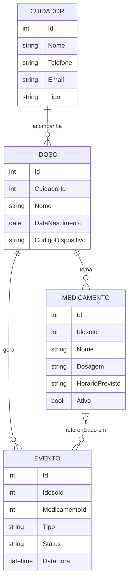

# CitizenTech API — Idoso em casa com mais segurança

API REST em **ASP.NET Core 8** com **Entity Framework Core** e **Oracle** (oracle.fiap.com.br), da Global Solution 2026/2 da FIAP (disciplina Advanced Business Development with .NET).

## Integrantes
| Ilda Ester Mussungayi Afonso | RM:568233 |


## Solução
Muitos idosos moram sozinhos ou passam o dia sem companhia. A solução CitizenTech usa um dispositivo (Arduino/ESP32) com botão de emergência e sensor na caixa de remédios. Cada ocorrência vira um **evento** na API, que o **cuidador** acompanha pelo app mobile.

- **Cidadão beneficiado:** idosos que vivem sozinhos e seus familiares ou cuidadores.
- **ODS:** 3 (Saúde e bem-estar) e 10 (Redução das desigualdades).
- Esta API é a base consumida pelo app Mobile e executada em container na entrega de DevOps.

## Diagrama das entidades


Tabelas no Oracle (criadas por Migrations): `NET_CUIDADOR`, `NET_IDOSO`, `NET_MEDICAMENTO`, `NET_EVENTO`.

## Como executar
Pré-requisitos: .NET SDK 8 e acesso ao Oracle da FIAP.

1. Defina a connection string **por variável de ambiente** (a senha não é versionada):
   ```bash
   # Linux/macOS
   export ORACLE_CONNECTION="User Id=RMXXXXXX;Password=SUA_SENHA;Data Source=oracle.fiap.com.br:1521/ORCL"
   # Windows (PowerShell)
   $env:ORACLE_CONNECTION="User Id=RMXXXXXX;Password=SUA_SENHA;Data Source=oracle.fiap.com.br:1521/ORCL"
   ```
2. Restaure e rode:
   ```bash
   dotnet restore
   dotnet ef database update    # aplica as Migrations (também é feito ao iniciar a API)
   dotnet run
   ```
3. A API sobe em `http://localhost:5000` (a porta aparece no terminal).

## Como testar
Ordem sugerida (os ids dependem do que já existe):

```bash
# 1) Cuidador  -> 201
curl -i -X POST http://localhost:5000/api/cuidadores -H "Content-Type: application/json" \
  -d '{"nome":"Ana Paula","telefone":"(11) 90000-0001","email":"ana@example.com","tipo":"FAMILIAR"}'

# 2) Idoso (use o id do cuidador criado) -> 201
curl -i -X POST http://localhost:5000/api/idosos -H "Content-Type: application/json" \
  -d '{"cuidadorId":1,"nome":"Maria das Dores","dataNascimento":"1941-03-15","codigoDispositivo":"ESP32-0001"}'

# 3) Medicamento -> 201
curl -i -X POST http://localhost:5000/api/medicamentos -H "Content-Type: application/json" \
  -d '{"idosoId":1,"nome":"Losartana","dosagem":"50 mg","horarioPrevisto":"08:00"}'

# 4) Evento -> 201
curl -i -X POST http://localhost:5000/api/eventos -H "Content-Type: application/json" \
  -d '{"idosoId":1,"tipo":"BOTAO_EMERGENCIA","observacao":"Acionado na sala"}'

# Listar / buscar / atualizar / excluir
curl -i http://localhost:5000/api/cuidadores
curl -i http://localhost:5000/api/cuidadores/1
curl -i -X PUT http://localhost:5000/api/cuidadores/1 -H "Content-Type: application/json" \
  -d '{"id":1,"nome":"Ana Paula Silva","telefone":"(11) 90000-0001","email":"ana@example.com","tipo":"FAMILIAR"}'   # 204
curl -i -X DELETE http://localhost:5000/api/eventos/1                                                              # 204

# Erros tratados
curl -i -X POST http://localhost:5000/api/cuidadores -H "Content-Type: application/json" -d '{"nome":""}'      # 400 (JSON com os erros)
curl -i http://localhost:5000/api/cuidadores/9999                                                              # 404 (JSON)
```

| Recurso | Rotas |
|---------|-------|
| Cuidadores | `/api/cuidadores` |
| Idosos | `/api/idosos` |
| Medicamentos | `/api/medicamentos` |
| Eventos | `/api/eventos` |

Cada recurso tem: `GET` (lista), `GET /{id}`, `POST` (201), `PUT /{id}` (204) e `DELETE /{id}` (204). Dado inválido devolve **400** em JSON; id inexistente devolve **404**; excluir registro com dependentes devolve **409**.

## Uso de IA generativa
Declaração: (preencher com as ferramentas usadas e para quê. Exemplo: Claude, para gerar o esqueleto do projeto e revisar o README; todo o código foi lido, entendido e testado pelo autor.)
